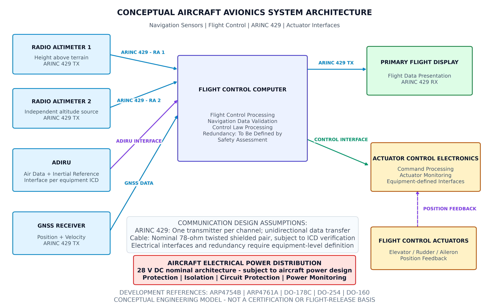

## Conceptual Aircraft Avionics System Architecture & ARINC 429 Protocol Interface

An illustrative systems engineering baseline and verification utility modeling an aircraft navigation and flight control integration architecture.

This project outlines Line Replaceable Unit (LRU) functional boundaries, simplex digital communication topologies, power distribution separation, and generic 32-bit **ARINC 429** word encoding under **SAE ARP4754B** and **ARP4761A** systems engineering and safety assessment frameworks.

---

## Architecture Blueprint



*Figure: Functional arrangement illustrating navigation sensors (dual Radio Altimeters, ADIRU, GNSS), dual Flight Control Computers (FCC A/B), Actuator Control Electronics (ACE), cockpit display, and isolated electrical power distribution.*

---

## Key Systems Engineering Considerations

* **Development Assurance Standards:** Aligned with **SAE ARP4754B** (Standard for Development of Civil Aircraft and Systems) and **SAE ARP4761A** (Safety Assessment Process). Note: A specific project baseline may maintain an agreed ARP4754A certification basis depending on program agreements.
* **Separation of Computation and Power Actuation:** Distinct allocation between Flight Control Computers (FCC A/B), Actuator Control Electronics (ACE), and actuator feedback loops to preserve fault isolation and failure containment.
* **Development Assurance Level (DAL) Allocation:** Avoids premature assignment of DAL A; actual item Development Assurance Levels (IDAL) must derive strictly from aircraft level Functional Hazard Assessments (FHA) and Preliminary System Safety Assessments (PSSA).
* **Deterministic Bus Boundaries:** ARINC 429 is treated strictly as a point-to-point or point-to-multipoint unidirectional bus with **one transmitter per channel**. Physical transmission media (nominal 78-ohm twisted shielded pair) is captured as an engineering design assumption subject to formal Interface Control Document (ICD) validation.
* **ICD-Driven Data Interpretation:** Acknowledges that data field scaling, signedness (BNR vs. BCD), resolution, and Sign/Status Matrix (SSM) definitions cannot be assumed globally and must be verified against actual vendor equipment ICDs.

---

## Technical Q&A (Avionics & Systems Architecture Insights)

### Q1: Why separate the Flight Control Computer (FCC) from the Actuator Control Electronics (ACE)?
Separating higher level flight guidance and control laws from direct surface drive electronics improves safety and maintainability:
* **Thermal and Electrical Isolation:** The ACE handles high-current switching, back-EMF, and hydraulic valve actuation, isolating the sensitive, high throughput digital processors in the FCC from inductive spikes and electrical noise.
* **Failure Containment:** Physical and functional segregation ensures that local actuator drive faults or feedback transducer shorts do not corrupt core multi sensor navigation and autopilot computational channels.

### Q2: Why must ARINC 429 encoders remain generic rather than hardcoding sensor resolutions?
While ARINC 429 sets standard parameter label allocations (e.g., Label 164 for Radio Altitude), actual equipment manufacturers customize implementation details within their specific Interface Control Documents (ICD):
* **Resolution Differences:** Different radio altimeter vendors or performance classes define distinct Least Significant Bit (LSB) weightings (e.g., 0.125 m/bit vs. fractional feet) and bit lengths within the 19-bit payload field.
* **SSM Semantics:** Sign/Status Matrix definitions (bits 30–31) often incorporate vendor-specific fault codes or discrete test states. Robust avionics verification utilities must treat the data payload generically until grounded in certified equipment interface data.

---

## Functional Equipment Allocation

| Equipment | Primary Function | Interface Type |
| :--- | :--- | :--- |
| **Radio Altimeter 1 & 2** | Independent terrain clearance height sensing | ARINC 429 TX (Unidirectional) |
| **ADIRU** | Air Data and Inertial Reference calculation | Equipment ICD-defined |
| **GNSS Receiver** | Absolute position and velocity sensing | ARINC 429 TX (Unidirectional) |
| **FCC (Channels A & B)** | Multi-channel flight-control processing, navigation monitoring | Multi-bus / Interface-defined |
| **Primary Flight Display (PFD)** | Cockpit flight information presentation | ARINC 429 RX |
| **Actuator Control Electronics (ACE)** | Surface command servo loop & actuator drive | Equipment-defined |
| **Flight Control Actuators** | Primary flight control surface displacement | ACE drive & position feedback |
| **Electrical Power System** | Regulated 28 V DC primary power distribution | Galvanically isolated bus |

---

## ARINC 429 Generic Word Structure

| Bit Field | Name | Definition |
| :--- | :--- | :--- |
| **Bits 1–8** | **Label** | 8-bit octal parameter ID (Transmitted LSB-first per ARINC standard) |
| **Bits 9–10** | **SDI** | Source/Destination Identifier for system redundancy tagging |
| **Bits 11–29** | **Data** | 19-bit payload (BNR / BCD scaled per equipment ICD) |
| **Bits 30–31** | **SSM** | Sign/Status Matrix (Health, validity, and operating mode indicator) |
| **Bit 32** | **Parity** | Odd parity bit dynamically calculated across all 31 proceeding bits |

---

## Implementation & Generation Code (Python)

Dependencies: `matplotlib`

```python

import matplotlib.pyplot as plt
import matplotlib.patches as patches

# ============================================================
# AIRCRAFT AVIONICS SYSTEM ARCHITECTURE
# Conceptual engineering model - not a certified design
#
# Development references:
# SAE ARP4754B / agreed certification basis
# SAE ARP4761A
# RTCA DO-178C (software, when applicable)
# RTCA DO-254 (airborne electronic hardware, when applicable)
# RTCA DO-160 (environmental qualification, when applicable)
#
# ARINC 429:
# One transmitter per channel, unidirectional communication.
# Nominal 78-ohm TSP is an interface design assumption.
# Verify cable and electrical requirements against the
# applicable equipment interface documentation.
# ============================================================


# ============================================================
# 1. GENERIC ARINC 429 WORD ENCODER
# ============================================================

def encode_arinc429_word(
    label_octal,
    sdi,
    data_raw,
    ssm
):
    """
    Generic ARINC 429 32-bit word packer.

    IMPORTANT:
    This function packs a 19-bit raw data field.
    It does NOT establish the data format of any particular
    ARINC 429 label.

    Label allocation, data format, scaling, signedness,
    SDI usage and SSM meaning must be confirmed from the
    applicable equipment ICD and ARINC specification.

    Parameters:
        label_octal : integer label in octal notation
        sdi         : 2-bit SDI value (0-3)
        data_raw    : 19-bit raw payload (0-524287)
        ssm         : 2-bit SSM value (0-3)

    Returns:
        32-character binary word
        8-character hexadecimal word
    """

    if not 0 <= label_octal <= 0o377:
        raise ValueError("Label must be an 8-bit octal value.")

    if not 0 <= sdi <= 3:
        raise ValueError("SDI must be between 0 and 3.")

    if not 0 <= data_raw <= 0x7FFFF:
        raise ValueError("Data must fit in 19 bits.")

    if not 0 <= ssm <= 3:
        raise ValueError("SSM must be between 0 and 3.")

    # ARINC 429 label bits are transmitted in reverse order
    # relative to the conventional displayed binary label.
    label_bits = f"{label_octal:08b}"[::-1]

    # Build fields using the conventional word representation.
    sdi_bits = f"{sdi:02b}"
    data_bits = f"{data_raw:019b}"
    ssm_bits = f"{ssm:02b}"

    first_31_bits = (
        label_bits +
        sdi_bits +
        data_bits +
        ssm_bits
    )

    # Set bit 32 to produce odd parity.
    parity_bit = (
        "0" if first_31_bits.count("1") % 2 == 1
        else "1"
    )

    binary_word = first_31_bits + parity_bit

    hexadecimal_word = (
        f"0x{int(binary_word, 2):08X}"
    )

    return binary_word, hexadecimal_word


def verify_arinc429_parity(binary_word):
    """Return True when a 32-bit word has odd parity."""

    if len(binary_word) != 32:
        raise ValueError("ARINC 429 word must contain 32 bits.")

    if any(bit not in "01" for bit in binary_word):
        raise ValueError("Word must contain only binary digits.")

    return binary_word.count("1") % 2 == 1


# Example: generic word-packing demonstration.
# Label 164 is used as an illustrative label only.
# The raw payload below is NOT asserted to be a valid
# Radio Altimeter altitude representation.

test_word, test_hex = encode_arinc429_word(
    label_octal=0o164,
    sdi=1,
    data_raw=1000,
    ssm=3
)

print("\nARINC 429 WORD PACKING TEST")
print("---------------------------")
print("Binary:", test_word)
print("Hex:   ", test_hex)
print("Odd parity valid:", verify_arinc429_parity(test_word))


# ============================================================
# 2. ARCHITECTURE DRAWING
# ============================================================

fig, ax = plt.subplots(figsize=(16, 10), dpi=180)

ax.set_xlim(0, 120)
ax.set_ylim(0, 100)
ax.axis("off")


# Colour palette
COLORS = {
    "sensor": "#E0F2FE",
    "sensor_border": "#0284C7",
    "computer": "#EEF2FF",
    "computer_border": "#4338CA",
    "display": "#DCFCE7",
    "display_border": "#15803D",
    "actuator": "#FEF3C7",
    "actuator_border": "#B45309",
    "power": "#FEE2E2",
    "power_border": "#DC2626",
    "arinc": "#0284C7",
    "feedback": "#7C3AED",
    "control": "#059669",
    "text": "#0F172A",
    "muted": "#475569"
}


# ============================================================
# 3. EQUIPMENT BLOCK FUNCTION
# ============================================================

def draw_equipment(
    x, y, w, h,
    title,
    description,
    category="sensor"
):

    bg = COLORS[category]
    border = COLORS[category + "_border"]

    box = patches.FancyBboxPatch(
        (x, y), w, h,
        boxstyle="round,pad=0.6",
        linewidth=1.8,
        edgecolor=border,
        facecolor=bg,
        zorder=3
    )

    ax.add_patch(box)

    ax.text(
        x + w / 2,
        y + h * 0.68,
        title,
        ha="center",
        va="center",
        fontsize=10,
        fontweight="bold",
        color=COLORS["text"],
        zorder=4
    )

    ax.text(
        x + w / 2,
        y + h * 0.31,
        description,
        ha="center",
        va="center",
        fontsize=8,
        color=COLORS["muted"],
        zorder=4
    )


# ============================================================
# 4. DIRECTIONAL DATA CONNECTION
# ============================================================

def draw_connection(
    start,
    end,
    label,
    color=None,
    offset=(0, 2),
    linestyle="-"
):

    if color is None:
        color = COLORS["arinc"]

    ax.annotate(
        "",
        xy=end,
        xytext=start,
        arrowprops=dict(
            arrowstyle="-|>",
            color=color,
            linewidth=2.0,
            linestyle=linestyle,
            mutation_scale=13
        ),
        zorder=2
    )

    mid_x = (start[0] + end[0]) / 2 + offset[0]
    mid_y = (start[1] + end[1]) / 2 + offset[1]

    ax.text(
        mid_x,
        mid_y,
        label,
        fontsize=7.5,
        color=color,
        fontweight="bold",
        ha="center",
        va="center",
        bbox=dict(
            facecolor="white",
            edgecolor="none",
            alpha=0.9,
            pad=1
        ),
        zorder=5
    )


# ============================================================
# 5. NAVIGATION AND SENSOR SUBSYSTEMS
# ============================================================

draw_equipment(
    3, 77, 23, 12,
    "RADIO ALTIMETER 1",
    "Height above terrain\nARINC 429 TX",
    "sensor"
)

draw_equipment(
    3, 59, 23, 12,
    "RADIO ALTIMETER 2",
    "Independent altitude source\nARINC 429 TX",
    "sensor"
)

draw_equipment(
    3, 38, 23, 13,
    "ADIRU",
    "Air Data + Inertial Reference\nInterface per equipment ICD",
    "sensor"
)

draw_equipment(
    3, 17, 23, 13,
    "GNSS RECEIVER",
    "Position + Velocity\nARINC 429 TX",
    "sensor"
)


# ============================================================
# 6. CENTRAL FLIGHT CONTROL COMPUTERS
# ============================================================

draw_equipment(
    43, 60, 32, 25,
    "FLIGHT CONTROL COMPUTER A",
    "Flight Control Processing\nNavigation Data Validation\nControl Law Processing\nSoftware / Hardware Assurance",
    "computer"
)

draw_equipment(
    43, 29, 32, 25,
    "FLIGHT CONTROL COMPUTER B",
    "Independent Processing Channel\nMonitoring and Fault Detection\nRedundancy Management\nInterface Monitoring",
    "computer"
)


# ============================================================
# 7. OUTPUT SYSTEMS
# ============================================================

draw_equipment(
    91, 70, 25, 15,
    "PRIMARY FLIGHT DISPLAY",
    "Flight Data Presentation\nARINC 429 RX",
    "display"
)

draw_equipment(
    91, 38, 25, 15,
    "ACTUATOR CONTROL ELECTRONICS",
    "Command Processing\nActuator Monitoring\nEquipment-defined Interfaces",
    "actuator"
)

draw_equipment(
    91, 12, 25, 13,
    "FLIGHT CONTROL ACTUATORS",
    "Elevator / Rudder / Aileron\nPosition Feedback",
    "actuator"
)


# ============================================================
# 8. SENSOR DATA CONNECTIONS
# ============================================================

draw_connection(
    (26, 83), (43, 79),
    "ARINC 429 - RA 1",
    offset=(0, 3)
)

draw_connection(
    (26, 65), (43, 74),
    "ARINC 429 - RA 2",
    offset=(-1, -2)
)

draw_connection(
    (26, 44), (43, 68),
    "ADIRU INTERFACE",
    offset=(-1, -2),
    color=COLORS["feedback"]
)

draw_connection(
    (26, 23), (43, 63),
    "GNSS DATA",
    offset=(-1, -3)
)


# ============================================================
# 9. FCC OUTPUT CONNECTIONS
# ============================================================

draw_connection(
    (75, 78), (91, 78),
    "ARINC 429 TX",
    offset=(0, 3)
)

draw_connection(
    (75, 42), (91, 46),
    "CONTROL INTERFACE",
    color=COLORS["control"],
    offset=(0, 3)
)


# ============================================================
# 10. ACTUATOR FEEDBACK
# ============================================================

draw_connection(
    (103, 25), (103, 38),
    "POSITION FEEDBACK",
    color=COLORS["feedback"],
    offset=(8, 0),
    linestyle="--"
)


# ============================================================
# 11. POWER DISTRIBUTION
# ============================================================

power_box = patches.FancyBboxPatch(
    (35, 3), 50, 9,
    boxstyle="round,pad=0.6",
    facecolor=COLORS["power"],
    edgecolor=COLORS["power_border"],
    linewidth=1.8,
    zorder=3
)

ax.add_patch(power_box)

ax.text(
    60, 7.5,
    "AIRCRAFT ELECTRICAL POWER DISTRIBUTION\n"
    "28 V DC nominal architecture - subject to aircraft power design\n"
    "Protection | Isolation | Circuit Protection | Power Monitoring",
    ha="center",
    va="center",
    fontsize=8,
    fontweight="bold",
    color=COLORS["text"]
)


# ============================================================
# 12. TECHNICAL ARCHITECTURE NOTES
# ============================================================

ax.text(
    60, 96,
    "CONCEPTUAL AIRCRAFT AVIONICS SYSTEM ARCHITECTURE",
    ha="center",
    fontsize=16,
    fontweight="bold",
    color=COLORS["text"]
)

ax.text(
    60, 92,
    "Navigation Sensors | Flight Control | ARINC 429 | Actuator Interfaces",
    ha="center",
    fontsize=10,
    color=COLORS["muted"]
)

ax.text(
    60, 15,
    "COMMUNICATION DESIGN ASSUMPTIONS:\n"
    "ARINC 429: One transmitter per channel; unidirectional data transfer\n"
    "Cable: Nominal 78-ohm twisted shielded pair, subject to ICD verification\n"
    "Electrical interfaces and redundancy require equipment-level definition",
    ha="center",
    va="center",
    fontsize=7.5,
    color=COLORS["muted"],
    bbox=dict(
        boxstyle="round,pad=0.5",
        facecolor="#F8FAFC",
        edgecolor="#CBD5E1"
    )
)


# ============================================================
# 13. DOCUMENTATION FOOTER
# ============================================================

ax.text(
    60, 0.5,
    "DEVELOPMENT REFERENCES: ARP4754B | ARP4761A | DO-178C | DO-254 | DO-160\n"
    "CONCEPTUAL ENGINEERING MODEL - NOT A CERTIFICATION OR FLIGHT-RELEASE BASIS",
    ha="center",
    fontsize=7,
    color="#64748B"
)


# ============================================================
# 14. EXPORT
# ============================================================

plt.tight_layout()

plt.savefig(
    "improved_avionics_architecture.png",
    dpi=300,
    bbox_inches="tight",
    facecolor="white"
)

plt.show()

print("\nArchitecture diagram generated.")
print("File: improved_avionics_architecture.png")
